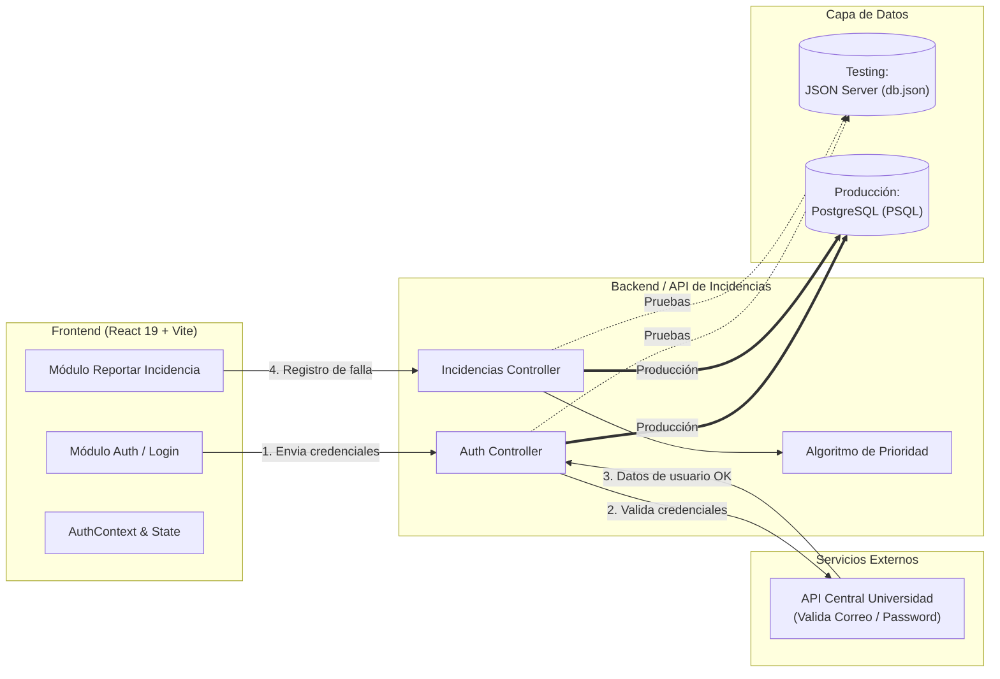
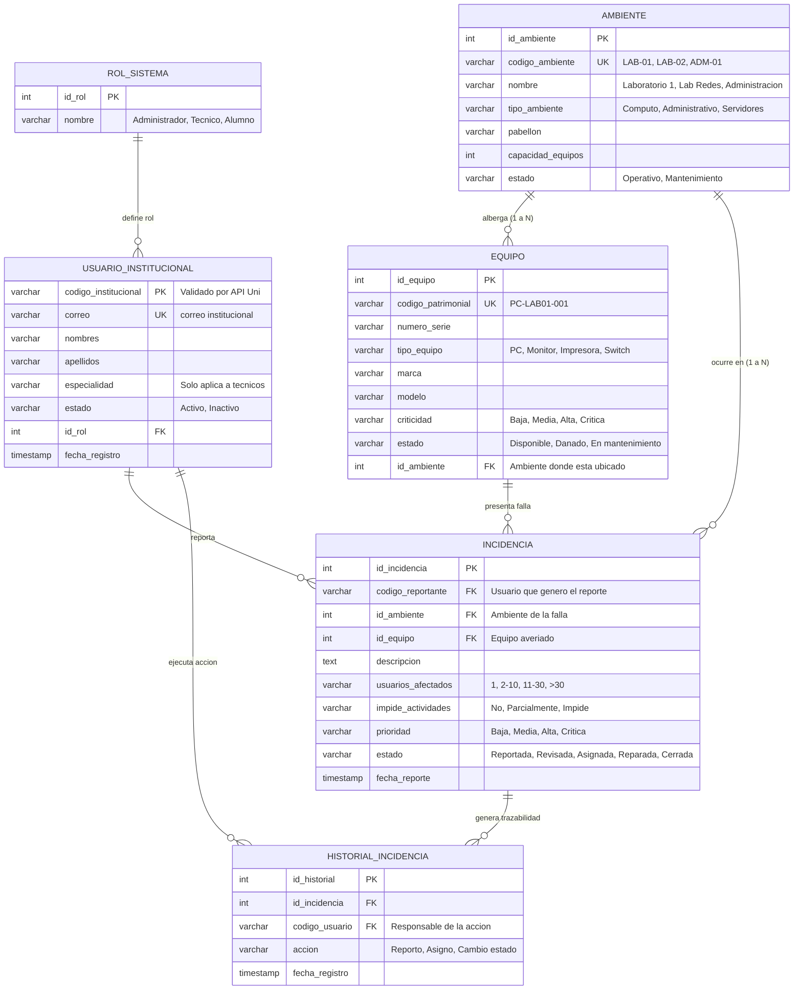
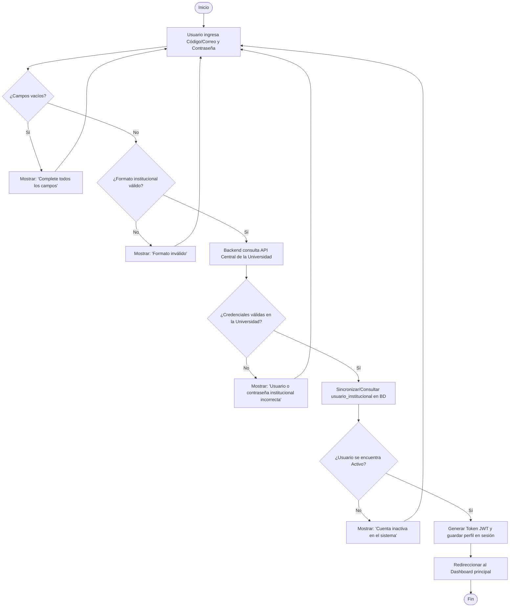
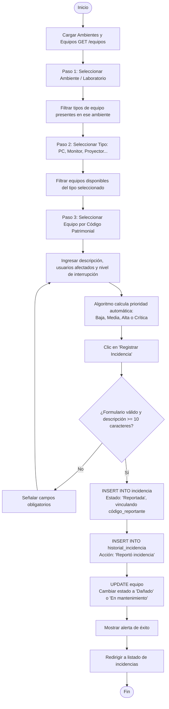

# Documentación Técnica del Sistema: Reporte y Gestión de Equipos Dañados
**Institución:** Universidad Nacional de Piura (UNP)  
**Escuela Profesional:** Ingeniería Informática  
**Módulos Clave:** Autenticación Institucional & Registro de Incidencias  
**Entornos:** Testing (JSON Server / `db.json`) | Producción (PostgreSQL)

---

## 1. Resumen Ejecutivo y Alcance

El **Sistema de Reporte de Equipos Dañados** es una solución integral diseñada para optimizar la gestión, trazabilidad y mantenimiento del equipamiento tecnológico en los diferentes **ambientes y laboratorios** de cómputo de la universidad.

El sistema contempla:
* **Autenticación Delegada (Federada):** La universidad es dueña de las credenciales de los usuarios; el sistema valida el correo y la contraseña a través de la **API Central Universitaria**, eliminando el almacenamiento local de contraseñas.
* **Soporte para Múltiples Ambientes:** Administración de diversos espacios físicos (*Laboratorio 1, Laboratorio 2, Laboratorio 3, Laboratorio 4, Oficinas Administrativas, etc.*).
* **Registro de Incidencias Inteligente:** Selección en cascada (*Ambiente ➔ Tipo de Equipo ➔ Equipo*) y cálculo algorítmico automatizado de la prioridad de atención.
* **Dualidad de Persistencia:** Modo de desarrollo/testing rápido mediante **JSON Server** (`db.json`) y arquitectura lista para producción con **PostgreSQL (PSQL)**.

---

## 2. Requisitos del Sistema

### 2.1. Requisitos Funcionales (RF)

#### Módulo de Autenticación
* **RF-01 (Validación Externa):** El sistema debe permitir iniciar sesión validando el identificador (correo institucional o código) y contraseña contra la API central de la universidad.
* **RF-02 (Cero Almacenamiento de Credenciales):** El sistema no debe almacenar contraseñas ni hashes en su base de datos local.
* **RF-03 (Roles de Sistema):** El sistema debe discriminar roles internos (`administrador`, `tecnico`, `alumno`) para proteger rutas y vistas en la interfaz.
* **RF-04 (Control de Estado de Cuenta):** Cuentas con estado `Inactivo` (p. ej., técnicos dados de baja) deben ser rechazadas con su respectivo mensaje.
* **RF-05 (Persistencia de Sesión):** Almacenar de forma segura el perfil de usuario y token de sesión para navegación continua.

#### Módulo de Registro de Incidencias
* **RF-06 (Gestión Multiambiente):** El sistema debe admitir múltiples ambientes (laboratorios, salas y áreas administrativas).
* **RF-07 (Selección en Cascada):** El formulario de registro debe filtrar de forma dinámica:
  1. *Ambiente* (solo muestra ambientes con equipos disponibles).
  2. *Tipo de Equipo* (solo los tipos presentes en dicho ambiente).
  3. *Equipo Específico* (por código patrimonial).
* **RF-08 (Cálculo Automático de Prioridad):** El sistema debe calcular la prioridad (`Baja`, `Media`, `Alta`, `Crítica`) cruzando la criticidad patrimonial del equipo con el impacto reportado (*usuarios afectados* y *nivel de interrupción*).
* **RF-09 (Trazabilidad y Auditoría):** Al crear una incidencia, se debe registrar automáticamente una entrada en el historial con fecha, hora, usuario reportante y acción realizada.
* **RF-10 (Transición de Estado del Equipo):** El equipo reportado debe cambiar su estado en el inventario a `Dañado` o `En mantenimiento`.

### 2.2. Requisitos No Funcionales (RNF)
* **RNF-01 (Seguridad):** Cumplimiento de estándares de privacidad institucional al no retener credenciales de los estudiantes o docentes.
* **RNF-02 (Responsividad y Portabilidad):** Interfaz fluida adaptable a computadoras de escritorio y dispositivos móviles (con capacidad de empaquetado como PWA o APK mediante Capacitor).
* **RNF-03 (Integridad Relacional):** En producción (PostgreSQL), garantizar claves foráneas (`ON DELETE RESTRICT`) y unicidad patrimonial.
* **RNF-04 (Rendimiento en Testing):** Uso de JSON Server para pruebas unitarias y de interfaz desacopladas de servidores SQL.

---

## 3. Stack Tecnológico

| Capa | Entorno de Pruebas / Testing | Entorno de Producción |
| :--- | :--- | :--- |
| **Frontend** | React 19, Vite, React Router v7 | React 19, Vite, React Router v7 |
| **UI & Estilos** | Bootstrap 5, Bootstrap Icons, CSS Custom | Bootstrap 5, Bootstrap Icons, CSS Custom |
| **Visualización** | Recharts (gráficos dinámicos) | Recharts |
| **Exportación** | jsPDF, jsPDF-AutoTable, XLSX | jsPDF, jsPDF-AutoTable, XLSX |
| **Backend / API** | JSON Server local (`npm run server`) | Backend REST (Node.js/Express, Spring o FastAPI) |
| **Autenticación** | Simulación en `db.json` / Mock API | API Central Universitaria (SSO / OAuth2 / LDAP) |
| **Base de Datos** | Archivo plano `src/data/db.json` | **PostgreSQL (PSQL)** (3ra Forma Normal) |

---

## 4. Arquitectura del Sistema



---

## 5. Modelo Relacional de Base de Datos (PostgreSQL - Producción)

### 5.1. Diagrama Entidad-Relación (DER)



### 5.2. Script DDL en PostgreSQL

```sql
-- Creación de tablas para entorno de producción (PostgreSQL)

CREATE TABLE rol_sistema (
    id_rol SERIAL PRIMARY KEY,
    nombre VARCHAR(50) NOT NULL UNIQUE
);

CREATE TABLE usuario_institucional (
    codigo_institucional VARCHAR(20) PRIMARY KEY,
    correo VARCHAR(100) NOT NULL UNIQUE,
    nombres VARCHAR(100) NOT NULL,
    apellidos VARCHAR(100) NOT NULL,
    especialidad VARCHAR(100),
    estado VARCHAR(20) DEFAULT 'Activo' CHECK (estado IN ('Activo', 'Inactivo')),
    id_rol INT NOT NULL REFERENCES rol_sistema(id_rol),
    fecha_registro TIMESTAMP DEFAULT CURRENT_TIMESTAMP
);

CREATE TABLE ambiente (
    id_ambiente SERIAL PRIMARY KEY,
    codigo_ambiente VARCHAR(20) NOT NULL UNIQUE,
    nombre VARCHAR(100) NOT NULL,
    tipo_ambiente VARCHAR(50) NOT NULL,
    pabellon VARCHAR(50),
    capacidad_equipos INT DEFAULT 0,
    estado VARCHAR(20) DEFAULT 'Operativo' CHECK (estado IN ('Operativo', 'Mantenimiento'))
);

CREATE TABLE equipo (
    id_equipo SERIAL PRIMARY KEY,
    codigo_patrimonial VARCHAR(50) NOT NULL UNIQUE,
    numero_serie VARCHAR(50),
    tipo_equipo VARCHAR(50) NOT NULL,
    marca VARCHAR(50) NOT NULL,
    modelo VARCHAR(50) NOT NULL,
    criticidad VARCHAR(20) DEFAULT 'Media' CHECK (criticidad IN ('Baja', 'Media', 'Alta', 'Crítica')),
    estado VARCHAR(30) DEFAULT 'Disponible' CHECK (estado IN ('Disponible', 'Dañado', 'En mantenimiento', 'De baja')),
    id_ambiente INT NOT NULL REFERENCES ambiente(id_ambiente),
    fecha_adquisicion DATE
);

CREATE TABLE incidencia (
    id_incidencia SERIAL PRIMARY KEY,
    codigo_reportante VARCHAR(20) NOT NULL REFERENCES usuario_institucional(codigo_institucional),
    id_ambiente INT NOT NULL REFERENCES ambiente(id_ambiente),
    id_equipo INT NOT NULL REFERENCES equipo(id_equipo),
    descripcion TEXT NOT NULL,
    usuarios_afectados VARCHAR(20) NOT NULL,
    impide_actividades VARCHAR(30) NOT NULL,
    prioridad VARCHAR(20) NOT NULL CHECK (prioridad IN ('Baja', 'Media', 'Alta', 'Crítica')),
    estado VARCHAR(30) DEFAULT 'Reportada' CHECK (estado IN ('Reportada', 'Revisada', 'Asignada', 'Reparada', 'Cerrada')),
    fecha_reporte TIMESTAMP DEFAULT CURRENT_TIMESTAMP
);

CREATE TABLE historial_incidencia (
    id_historial SERIAL PRIMARY KEY,
    id_incidencia INT NOT NULL REFERENCES incidencia(id_incidencia) ON DELETE CASCADE,
    codigo_usuario VARCHAR(20) NOT NULL REFERENCES usuario_institucional(codigo_institucional),
    accion VARCHAR(100) NOT NULL,
    fecha_registro TIMESTAMP DEFAULT CURRENT_TIMESTAMP
);
```

---

## 6. Diagramas de Flujo de Procesos

### 6.1. Flujo de Autenticación (Login)



### 6.2. Flujo de Registro de Incidencia



---

## 7. Guía de Ejecución Rápida

### Modo Testing (Actual)
```bash
# 1. Instalar dependencias
npm install

# 2. Iniciar base de datos simulada (puerto 3001)
npm run server

# 3. Iniciar aplicación React (puerto 5173)
npm run dev
```

### Variables de Entorno (`.env`)
* **Testing:** `VITE_API_URL=http://localhost:3001`
* **Producción:** `VITE_API_URL=https://api-reportes.unp.edu.pe` (o URL del backend conectado a PostgreSQL).
