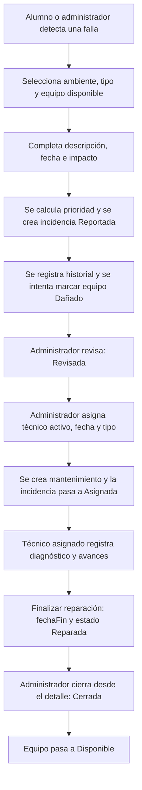
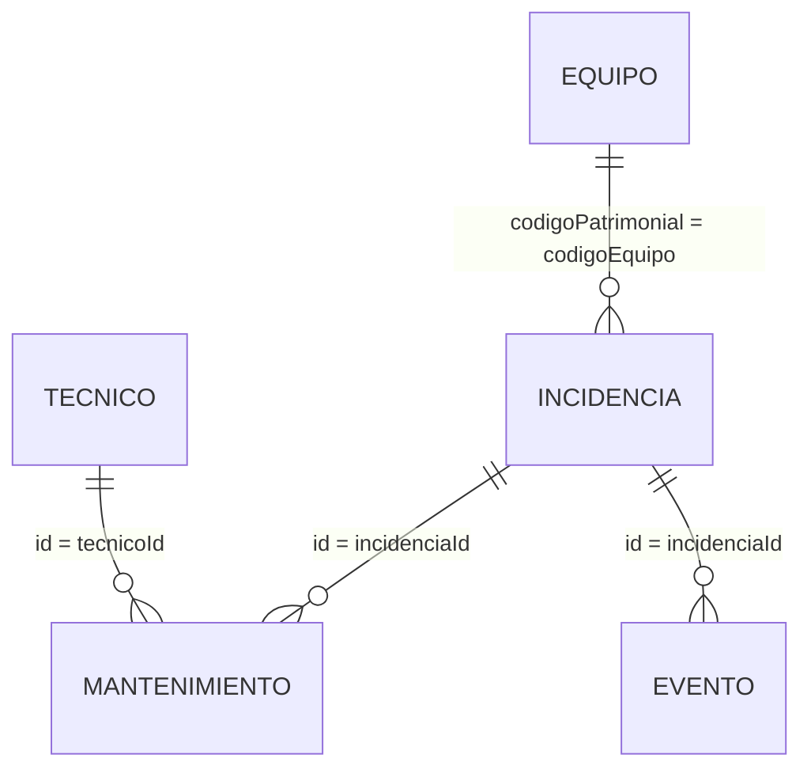

# Referencia del funcionamiento actual del sistema

> Referencia histórica de la versión restaurada, anterior a esta implementación. El funcionamiento actualizado se documenta en [CAMBIOS_MANTENIMIENTO.md](CAMBIOS_MANTENIMIENTO.md).

Fecha de revisión: 16 de noviembre de 2026. Versión: proyecto restaurado después del rollback solicitado.

Este documento conserva el funcionamiento observado en el código de la aplicación raíz. Es una revisión estática: no afirma que cada operación haya sido ejecutada en navegador. No incluye las mejoras retiradas por el rollback y no modifica el comportamiento del sistema. Para futuras modificaciones, esta es la referencia del comportamiento de partida; deberá actualizarse si se implementan cambios.

## 1. Propósito y alcance

Aplicación académica de soporte a equipos informáticos de la UNP. Registra fallas, permite al administrador revisarlas y asignarlas a técnicos, documenta su atención y conserva consultas de inventario, historial y reportes.

La unidad principal del proceso es la incidencia. El mantenimiento se crea al asignar una incidencia a un técnico. El módulo actual no ofrece programación independiente de mantenimiento por equipo.

Los nombres visibles no están unificados: el acceso dice Sistema de Reporte de Equipos, la barra superior Sistema de Gestión de Incidencias y el título del sitio Sistema de Reporte de Equipos Dañados. UNP Soporte es la marca del menú.

## 2. Estructura que se está usando

- Entrada: `src/main.jsx`, con React, BrowserRouter y Bootstrap.
- Rutas y layout: `src/App.jsx`.
- Dashboard conectado a la ruta principal: `src/pages/Dashboard.jsx`.
- `src/components/Dashboard.jsx` es un componente alternativo; no es el dashboard importado por App y utiliza otros estados. No tomar sus estados como el flujo principal.
- Servicios HTTP: `src/services/api.js`; la base de URL procede de `VITE_API_URL`.
- Base del comando de servidor en la raíz: `src/data/db.json`.
- Alternativa de servidor en `backend`: su comando start usa `backend/db.json`. Son archivos separados, no una sincronización ni una misma base compartida.
- `src/data/db_backup.json` es una copia de datos, no la base que señala el comando raíz.
- La carpeta anidada `SistemaReportes-main/` es otra copia del proyecto. Esta referencia describe `src/` en la raíz, no esa copia ni el respaldo del rollback.

La persistencia actual es JSON Server. No hay una implementación PostgreSQL ni una integración real con una API institucional en los servicios revisados, aunque la documentación previa describe escenarios de producción.

## 3. Roles y responsabilidades

| Rol interno | Papel en el proceso | Menú habitual |
| --- | --- | --- |
| `alumno` | Reporta una falla y consulta el seguimiento de sus reportes | Dashboard, Nueva incidencia, Listado |
| `administrador` | Revisa reportes, asigna técnicos y fechas, cierra incidencias y administra equipos y personal | Dashboard, Nueva incidencia, Listado, Gestión mantenimientos, Inventario, Técnicos, Reportes |
| `tecnico` | Consulta sus trabajos asignados, registra diagnóstico y acciones y marca la reparación como terminada | Dashboard, Mis mantenimientos |

### Autenticación y sesión

El login admite el identificador literal de administrador, códigos de alumno de nueve dígitos y códigos técnicos con formato TEC seguido de tres dígitos. Consulta las colecciones usuarios y tecnicos y compara código y contraseña desde el cliente. Rechaza técnicos con estado Inactivo. No existe registro público de alumnos en las pantallas revisadas.

Al iniciar sesión guarda el objeto de usuario en `localStorage` bajo la clave `usuario`; al recargar lo recupera. Al salir elimina ese objeto. No hay intercambio de token ni autenticación federada implementada. El formulario de técnicos registra también credenciales locales. No se reproducen contraseñas de ejemplo en esta referencia.

### Menú, rutas y datos son controles diferentes

`ProtectedRoute` exige tener un usuario. `RoleProtectedRoute` exige además coincidir con el rol indicado, o redirige al dashboard. Ocultar una opción del menú no equivale a bloquear su ruta.

| Ruta | Control declarado en App |
| --- | --- |
| `/login` | Pública |
| `/` | Sesión iniciada |
| `/nueva-incidencia` | Sesión iniciada; el menú la oculta al técnico |
| `/incidencias` | Sesión iniciada; el menú la oculta al técnico |
| `/incidencias/:id` | Sesión iniciada; el detalle no comprueba pertenencia del registro al usuario |
| `/editar-incidencia/:id` | Administrador |
| `/mantenimientos` | Administrador |
| `/mis-mantenimientos` | Técnico |
| `/inventario` | Sesión iniciada; el menú solo lo ofrece al administrador |
| `/nuevo-equipo`, `/editar-equipo/:id` | Administrador |
| `/equipo/:codigo/historial` | Sesión iniciada y comprobación adicional dentro de la página |
| `/tecnicos`, `/nuevo-tecnico`, `/editar-tecnico/:id` | Administrador |
| `/reportes` | Administrador |

El listado de incidencias muestra todos los registros al administrador; para otros roles filtra por el nombre o código del reportante. Por tanto, acceder directamente al listado como técnico no equivale a ver sus asignaciones: estas se consultan en Mis mantenimientos y en su dashboard.

En el historial por equipo, el alumno debe haber reportado alguna incidencia de ese equipo. El técnico debe tener algún mantenimiento asociado a sus incidencias. Superada esa comprobación, se cargan las incidencias y el historial del equipo, no solo las entradas propias. El administrador no tiene esa restricción adicional.

Los controles descritos están en React. No constituyen autorización del servidor JSON ni protección de los datos frente a solicitudes directas.

## 4. Flujo principal: de la falla al cierre

Este diagrama describe el recorrido principal previsto por las pantallas de detalle. El listado permite caminos adicionales de cambio de estado que se detallan más adelante.

| Momento | Actor | Escrituras que realiza el código |
| --- | --- | --- |
| Registrar | Alumno o administrador desde el menú habitual | Crea incidencia en Reportada; crea evento Reportó incidencia; intenta actualizar equipo a Dañado |
| Revisar | Administrador | Actualiza incidencia a Revisada y añade evento de cambio de estado |
| Asignar | Administrador | Crea mantenimiento con incidencia, equipo, técnico, fecha, tipo y observaciones; cambia incidencia a Asignada; añade evento Asignó técnico |
| Guardar progreso | Técnico asignado, mientras la incidencia está Asignada | Actualiza datos del mantenimiento y añade evento Actualizó progreso |
| Finalizar | Técnico asignado | Guarda datos y fechaFin del mantenimiento; cambia incidencia a Reparada; añade evento Finalizó mantenimiento |
| Cerrar desde detalle | Administrador, cuando está Reparada | Cambia incidencia a Cerrada; registra evento; busca equipo por código y lo cambia a Disponible |

No existe botón operativo de inicio de mantenimiento en esta versión. Al asignar se inicializa `fechaInicio` vacía; guardar avances y finalizar no la completan. La fecha programada es una fecha de planificación, no una fecha real de inicio.

La incidencia y el equipo tienen estados distintos. El flujo principal automatiza Dañado al registrar y Disponible al cerrar desde detalle; asignar o finalizar no cambia automáticamente el equipo a En mantenimiento. El administrador puede cambiar el estado del equipo manualmente al editarlo.

## 5. Registro y prioridad de una incidencia

Fuentes: `src/pages/NewIncident.jsx`, `src/components/IncidentForm.jsx`.

La selección es en cascada: ambiente o ubicación, tipo de activo y equipo específico por código patrimonial. Los tres selectores se construyen con equipos cuyo estado es Disponible. Cambiar ambiente o tipo limpia selecciones dependientes. La fecha se inicializa con el día UTC y el reportante con `user.nombre`; el reportante es de solo lectura.

El registro exige ambiente, tipo, equipo, descripción de al menos diez caracteres, fecha, reportante, cantidad de usuarios afectados y nivel de interrupción. Guarda equipoId y codigoEquipo, tipoEquipo, laboratorio, descripción, fecha, reportante, prioridad, estado y los factores de impacto. El estadoEquipo usado en el formulario se elimina antes de guardar.

Cálculo de prioridad:

| Factor | Aporte |
| --- | --- |
| Criticidad Baja / Media / Alta | 1 / 2 / 4 puntos |
| Criticidad Crítica | Prioridad Crítica directa |
| Criticidad ausente | Se considera Media |
| Usuarios: 1 / 2-10 / 11-30 / más de 30 | 0 / 1 / 2 / 3 puntos |
| Interrupción: Afecta parcialmente / Impide actividades | 1 / 2 puntos |

Resultado por suma: hasta 2 Baja; hasta 4 Media; hasta 6 Alta; más de 6 Crítica. El campo de prioridad se muestra calculado y no editable.

Editar actualiza la incidencia, sin añadir un evento de edición ni repetir la actualización del equipo. Se bloquea la edición de incidencias Cerradas en el formulario. Ambiente, tipo y equipo se deshabilitan al editar. Hay una limitación adicional: NewIncident convierte el parámetro de ID a Number, aunque JSON Server también puede producir IDs alfanuméricos.

No hay lector de código de barras ni búsqueda por API UNP en la versión restaurada.

## 6. Módulos y componentes

| Módulo | Qué hace actualmente | Fuentes principales |
| --- | --- | --- |
| Autenticación | Inicio y cierre de sesión, perfil en contexto y localStorage, protección de rutas | `src/auth/`, `src/pages/Login.jsx` |
| Navegación | Muestra menús por rol, barra superior y adaptación del menú lateral | `src/App.jsx`, `src/components/Sidebar.jsx`, `src/components/Navbar.jsx` |
| Dashboard | Resumen de incidencias, equipos, trabajos y actividad; tarjetas e indicadores según rol | `src/pages/Dashboard.jsx`, `src/components/Statistics.jsx`, `src/components/IncidentCard.jsx` |
| Nueva/editar incidencia | Selección en cascada, descripción, impacto y prioridad | `src/pages/NewIncident.jsx`, `src/components/IncidentForm.jsx` |
| Listado de incidencias | Consulta, filtros, detalle y operaciones administrativas | `src/components/IncidentList.jsx`, `src/components/Filters.jsx` |
| Detalle de incidencia | Datos del reporte, revisión, asignación, cierre, eliminación e historial | `src/pages/IncidentDetails.jsx` |
| Gestión de mantenimientos | Tabla administrativa de trabajos asignados; equipo, técnico, fecha y estado de la incidencia; enlace al detalle | `src/pages/MaintenanceManagement.jsx` |
| Mis mantenimientos | Trabajos con tecnicoId igual al ID de sesión; filtros por estado, prioridad y laboratorio; acceso al detalle | `src/pages/MyMaintenances.jsx` |
| Registro técnico | Diagnóstico, actividades, repuestos, observaciones y horas; guardar avances y finalizar | `src/components/MaintenanceTracker.jsx` |
| Inventario | Consulta y filtros de equipos, estado operativo, antigüedad, orientación de mantenimiento y acceso al historial; altas, cambios y bajas administrativas | `src/pages/Inventory.jsx`, `src/pages/NewEquipment.jsx`, `src/components/EquipmentList.jsx`, `src/components/EquipmentForm.jsx` |
| Historial por equipo | Resumen, mantenimientos e historial de eventos; filtros y trazabilidad por código patrimonial | `src/pages/EquipmentHistory.jsx` |
| Historial de incidencia | Eventos ordenados del más reciente al más antiguo, usuario, fecha, acción y observación | `src/components/IncidentHistory.jsx` |
| Técnicos | Consulta, búsqueda por nombre/DNI/especialidad, alta, edición y eliminación; estado Activo/Inactivo | `src/pages/Technicians.jsx`, `src/pages/NewTechnician.jsx`, `src/components/TechnicianForm.jsx` |
| Reportes | Incidencias, equipos, técnicos y laboratorios en PDF y Excel; informe ejecutivo en PDF | `src/pages/Reports.jsx` |
| Servicios de datos | Operaciones HTTP GET, POST, PUT y DELETE sobre las colecciones de JSON Server | `src/services/api.js` |

### Dashboard y estadísticas

Las incidencias se filtran por rol: administrador ve todas; alumno, las que coinciden con su nombre o código como reportante; técnico, las que están asociadas a sus mantenimientos. Sin embargo, equipos y mantenimientos se cargan completos, de modo que no todas las métricas están limitadas al mismo alcance. La actividad global y catálogo de técnicos se cargan para el administrador.

Se calculan incidencias abiertas, críticas, asignadas, reparadas y cerradas, equipos disponibles/dañados/en mantenimiento, tiempos por fechas, tasa de cierre, laboratorios y equipos con más incidencias. Statistics presenta agrupaciones por laboratorio, estado, prioridad, mes y rankings. Su ranking de técnicos cuenta asignaciones, aunque se presenta como mantenimientos realizados; no exige fecha de finalización.

### Listado

Filtra por código o ID, laboratorio, prioridad y estado, y ordena por fecha. Sin un estado seleccionado excluye las Cerradas: la opción visual de todos los estados no implica que se vean cerradas por defecto. El filtro simple de prioridades ofrece Alta, Media y Baja, aunque el cálculo también produce Crítica.

El administrador puede editar y eliminar registros no cerrados desde el listado. El detalle también muestra eliminación al administrador. El selector de estado del listado permite Reportada, Revisada o Cerrada; Asignada y Reparada aparecen deshabilitadas. Por ello puede cerrar antes de completar el recorrido principal. Ese manejador actualiza incidencia e historial, pero no libera el equipo como sí hace el cierre desde el detalle.

### Mantenimiento

Al asignar una incidencia se selecciona un técnico Activo, una fecha obligatoria, tipo Correctivo/Preventivo/Predictivo y observaciones opcionales. El tipo es una clasificación almacenada; no existen tres procesos diferentes ni mediciones o predicción automática.

El técnico solo puede editar MaintenanceTracker si su ID coincide exactamente con tecnicoId y la incidencia está Asignada. Los campos son diagnóstico, actividades, repuestos, observaciones y tiempo empleado en horas. Finalizar pide confirmación y guarda fechaFin como fecha UTC sin hora. No exige diagnóstico, actividades u horas positivas para finalizar. La función handleChangeStatus existe, pero no está conectada a un botón en el JSX revisado.

Gestión de mantenimientos muestra el estado de la incidencia; no hay un estado propio de mantenimiento gestionado por esa pantalla. Los mantenimientos dependen de incidenciaId para recuperar contexto y navegar al detalle.

### Inventario

Campos: codigoPatrimonial, numeroSerie, tipoEquipo, marca, modelo, laboratorio, estado, fechaAdquisicion y observaciones. La criticidad aparece en los datos de equipos y se usa al priorizar incidencias, pero no forma parte de los campos iniciales del formulario de alta.

Estados operativos disponibles: Disponible, En mantenimiento, Dañado y Retirado. La validación exige código, tipo, marca, modelo, ubicación, estado y fecha de adquisición. No comprueba unicidad patrimonial ni impide modificar un código utilizado por incidencias.

Las etiquetas orientativas se calculan por orden: con cinco años o más recomienda reemplazo; con al menos tres incidencias o cuatro años pide evaluación; con seis meses sin mantenimiento pide mantenimiento; con cuatro meses avisa próximo mantenimiento; en otro caso indica Al día. No son predicciones: son reglas de antigüedad y frecuencia. Busca mantenimientos por las incidencias asociadas al código del equipo.

### Historial por equipo

Encuentra el equipo por codigoPatrimonial y sus incidencias por codigoEquipo. Luego encuentra mantenimientos y eventos por incidenciaId. Incluye conteos preventivos/correctivos y tiempos calculados con fechas de inicio y fin. Hay filtros de fecha, tipo y estado. El tipo Predictivo existe en la asignación pero no tiene indicador propio equivalente a los otros dos en este resumen.

### Gestión de técnicos

El alta guarda código de acceso, contraseña, rol tecnico, DNI, nombres, apellidos, especialidad, teléfono, correo, estado y fecha de ingreso. El DNI exige ocho dígitos y el código el patrón TECxxx. Los nombres se guardan separados; el formulario de alta no construye un campo nombre como el que tienen algunos técnicos de ejemplo. Esto importa porque otras pantallas utilizan user.nombre al registrar acciones. No se observa validación de unicidad de código o DNI ni restricción de borrado por asignaciones existentes.

### Reportes

Incidencias permite filtrar fecha inicial/final, laboratorio, estado, prioridad, técnico y equipo. Las otras familias calculan resúmenes propios; esos filtros no se aplican automáticamente a todo el centro de reportes. El reporte de equipos y el de laboratorios buscan mantenimientos a través de las incidencias. El reporte de técnicos compara asignados y finalizados por fechaFin. El ejecutivo resume incidencias, tasa de resolución y situación del inventario.

Hay dos detalles de implementación a conservar como observaciones: equiposData utiliza eq.tipo aunque el inventario guarda tipoEquipo, y la exportación PDF de equipos define seis encabezados para filas con nueve valores. Esta revisión los documenta, no los corrige.

## 7. Datos y relaciones

El diagrama representa referencias lógicas en JSON, no claves foráneas garantizadas por un motor relacional. La interfaz normalmente crea un mantenimiento por incidencia y el detalle toma el primer registro coincidente; el almacenamiento no impone esa unicidad.

| Colección / endpoint | Contenido y vínculos |
| --- | --- |
| usuarios | ID, código, credenciales locales, rol y nombre de alumnos/administrador |
| tecnicos | Perfil, credenciales locales, código, rol, estado y datos de contacto |
| equipos | ID interno, código patrimonial, serie, tipo, ubicación y estado |
| incidencias | ID, equipoId y codigoEquipo, tipo/ubicación, reportante por texto, descripción, impacto, prioridad, fecha y estado |
| mantenimientos | ID, incidenciaId, equipoId, tecnicoId, nombreTecnico, tipo, fechas y registro de atención |
| historialIncidencias | ID, incidenciaId, usuario por texto, acción, observación y fecha ISO |

El API crea la fecha de los eventos con new Date().toISOString(). Los reportantes se comparan por nombre o código, no mediante una referencia estable reportanteId. Varias relaciones usan comparación estricta entre IDs; mezclar números y texto puede ocultar registros.

## 8. Límites observados que no deben confundirse con funciones implementadas

1. No hay API UNP, SSO, escáner ni consulta de inventario institucional implementados.
2. No hay programación autónoma de preventivos ni motor predictivo; los tres nombres son opciones en una asignación ligada a incidencia.
3. No hay inicio real de mantenimiento registrado por el flujo técnico, pese a mostrarse fechaInicio y usarse para estadísticas.
4. El ciclo de estados es el recorrido previsto por el detalle, pero no una máquina de estados validada en servidor; el listado permite saltos.
5. Cerrar desde listado y desde detalle tiene efectos diferentes sobre el inventario.
6. No hay transacciones entre las escrituras de incidencia, equipo, mantenimiento e historial. Un fallo intermedio puede dejar registros parciales. Algunos errores solo se muestran en consola.
7. Ocultar menús y proteger rutas no protege los endpoints JSON. La sesión incluye datos del usuario y las credenciales se comparan localmente.
8. Cambiar códigos o borrar equipos, técnicos o incidencias no tiene comprobaciones explícitas de integridad en los servicios cliente.
9. El historial por equipo requiere una relación previa, pero puede mostrar información del equipo más amplia que los reportes propios del alumno o técnico.
10. Algunas métricas describen asignaciones como trabajos realizados, y algunas vistas no contemplan Crítica o Predictivo de forma completa.
11. Los tiempos basados en fechaInicio pueden quedar incompletos para trabajos creados con el flujo actual.
12. El alta de técnico no construye nombre; los registros de ejemplo y los nuevos pueden tener distinta estructura para ese campo.

## 9. Cómo usar esta referencia en próximas tareas

Antes de cambiar un módulo, revisar las relaciones y las pantallas consumidoras: autenticación afecta todas las rutas; códigos de equipos afectan incidencias, historial e informes; asignaciones afectan vistas del técnico y métricas; estados afectan listados, inventario y reportes.

Este archivo documenta el estado actual y sus limitaciones. Las correcciones del profesor conversadas anteriormente son propuestas pendientes después del rollback, no funciones presentes. Cualquier trabajo posterior debe partir de esta distinción.

No se modificaron código de aplicación, datos, dependencias ni configuración para elaborar esta referencia.

## 10. Identificadores de la versión revisada

Huellas SHA-256 de los archivos centrales; sirven para saber si el flujo documentado ha cambiado.

| Archivo | SHA-256 |
| --- | --- |
| `src/App.jsx` | `6d15c9e8c557f31fb65527b1dfaf4f03636266c6cfd609c77c3e93dfd8dcea56` |
| `src/auth/AuthContext.jsx` | `eefb10483df18f111569ce23615f4c1d2e032f796273daeee66ac16d645d3b84` |
| `src/components/IncidentForm.jsx` | `43932e451d28b762dffb5395b7820e4732c5198ef28f0e292a9758912d727344` |
| `src/pages/IncidentDetails.jsx` | `7244b2fb18ad1b7b5a29f06092478de0e7bb5e0309b634e2ed01449a8567b2c5` |
| `src/components/MaintenanceTracker.jsx` | `793675495b2f85ed90b04b8d90c10f7a6433807bb930b53eaba89915aec80f6f` |
| `src/services/api.js` | `0cefbd2b679d547a7c3ce0888bdde47c871dac5ec78b2e60438c751e9318a0d0` |
